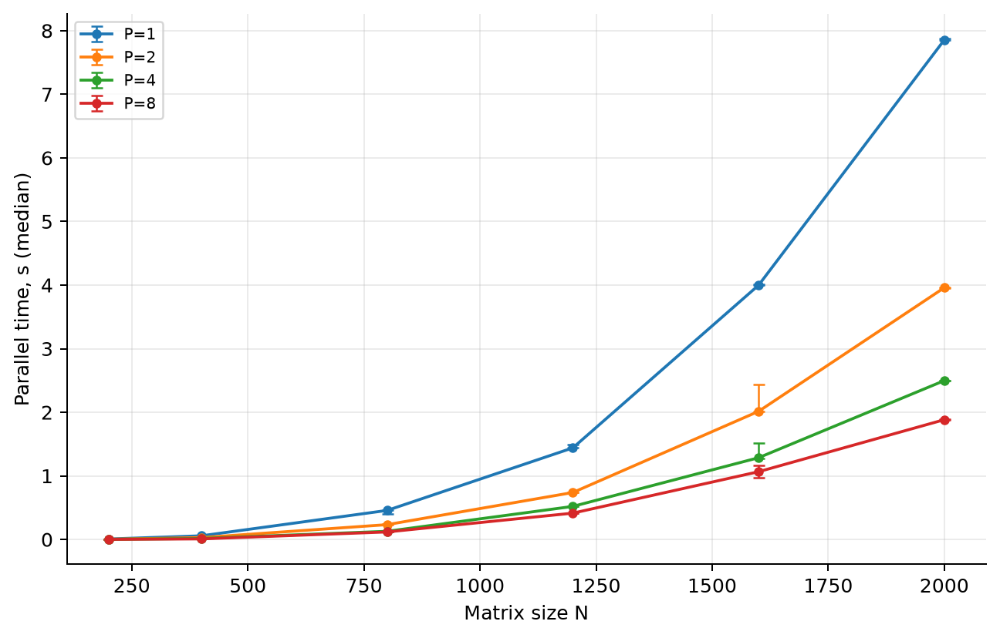
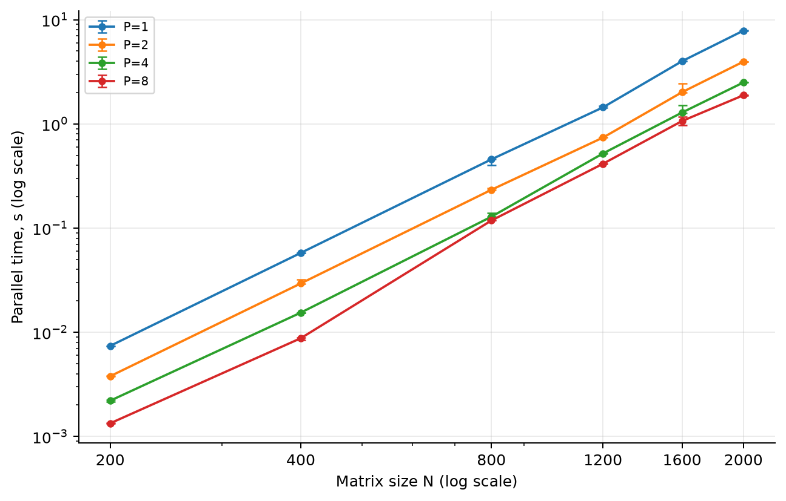
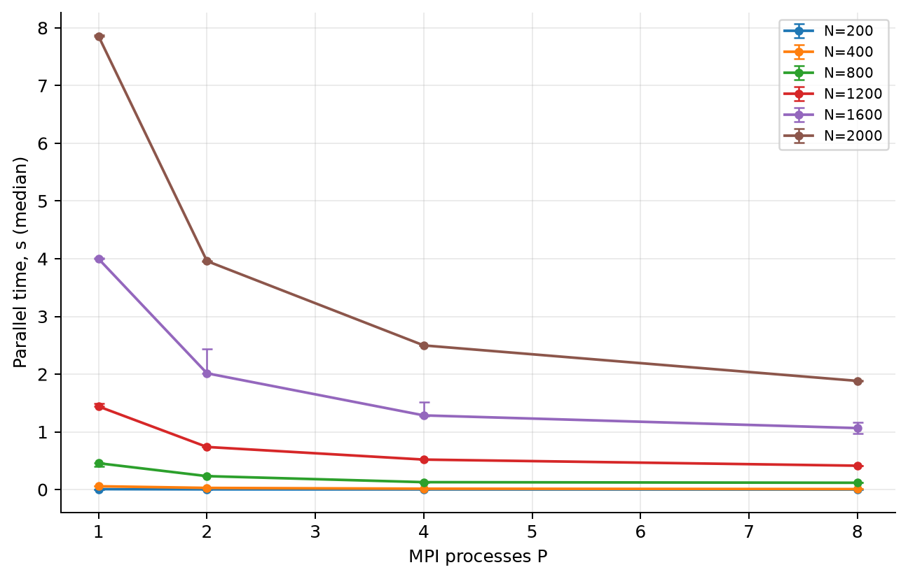
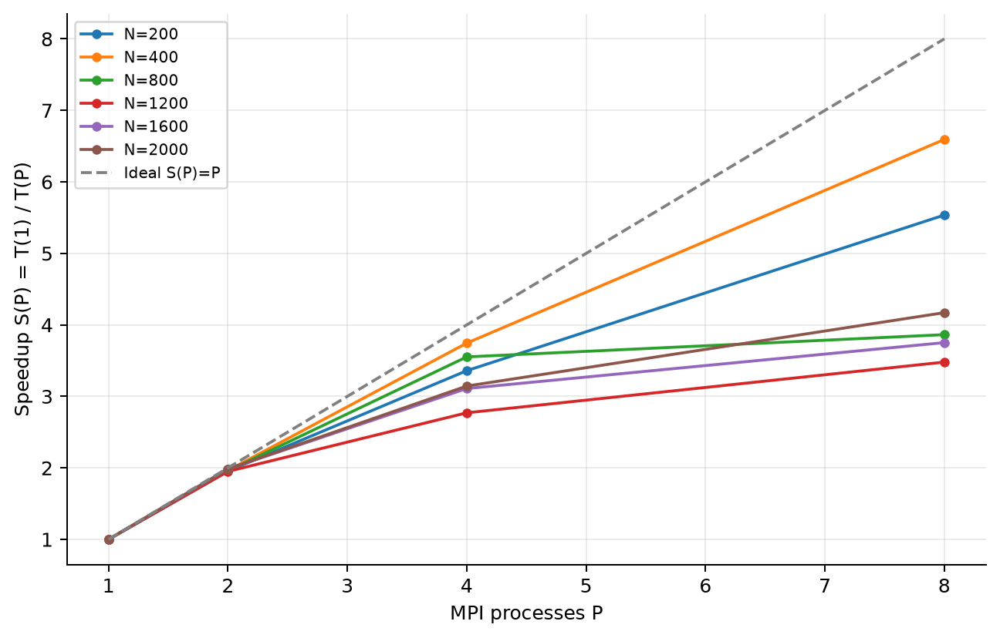
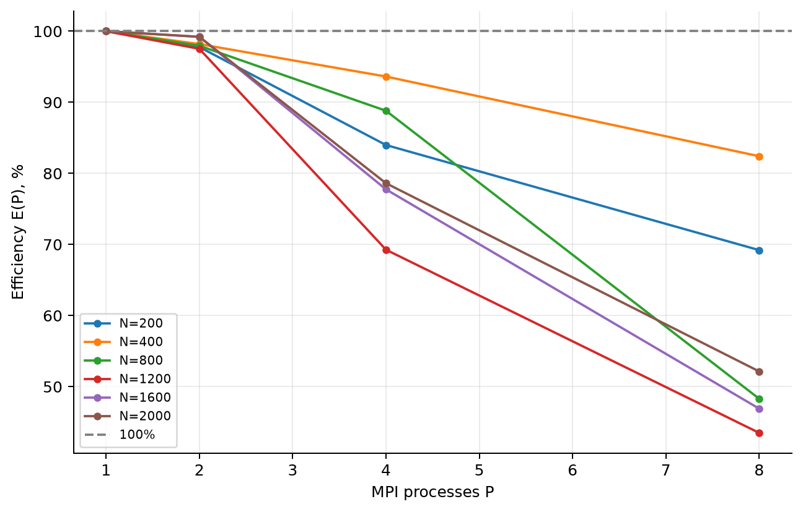
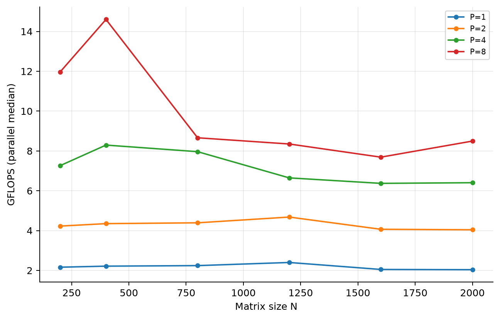
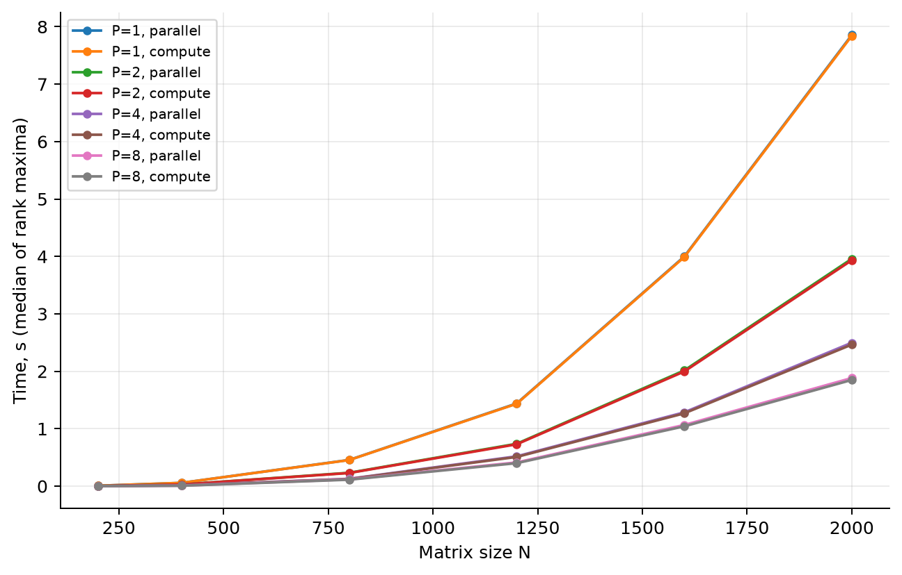

# Лабораторная работа 3 Параллельное умножение матриц с MPI

## Цель и задание

Модифицировать программу первой лабораторной работы для параллельного исполнения
по технологии MPI. Выполнить умножение двух квадратных матриц, провести
эксперименты при разных размерах и числе процессов, запустить MPI-версию
на суперкомпьютере «Сергей Королёв». Сохранить результат и проверить его
независимой библиотекой. Исследовать время, ускорение и эффективность.

Реализована построчная декомпозиция. Обработаны результаты четырёх Slurm-задач:
по шесть размеров и пять измерений для 1, 2, 4 и 8 процессов.
Для каждого размера наименьшее медианное время среди исследованных вариантов
получено при восьми процессах. Проверка NumPy выполнена для всех 24 матриц C.

## Исходные данные эксперимента

Эксперименты выполнены на суперкомпьютере «Сергей Королёв» в четырёх
Slurm-задачах. Результаты каждой задачи сохранены в отдельном каталоге
`results/sizes_...`. Номера задач указаны в названиях каталогов,
число процессов и использованных узлов — в CSV. Для локальной проверки
использованы сохранённые исходные матрицы из `data` и результирующие
матрицы C из каталогов задач.

| Задача Slurm | Каталог | MPI процессов | Узлов по CSV | Измерений |
|---:|---|---:|---:|---:|
| 353036 | sizes_353036 | 1 | 1 | 30 |
| 353035 | sizes_353035 | 2 | 1 | 30 |
| 353033 | sizes_353033 | 4 | 1 | 30 |
| 353022 | sizes_353022 | 8 | 1 | 30 |

Размеры: N = 200, 400, 800, 1200, 1600, 2000. Получено 6 × 4 × 5 = 120 измерений,
по одной результирующей матрице на конфигурацию. В каждом каталоге задачи
находятся `bench.csv`, шесть матриц `C_N_pP.txt` и протокол `verification.jsonl`.
Объединённые измерения находятся в [results/combined/bench.csv](results/combined/bench.csv),
сводная статистика — в [results/combined/summary.csv](results/combined/summary.csv),
общий протокол проверки — в [results/combined/verification.jsonl](results/combined/verification.jsonl).
Соответствие P и номера задачи приведено в таблице выше.

Каталог `results/combined` содержит данные обработки и изображения.

Все запуски использовали один узел.

## Математическая постановка

$$C_{ij}=\sum_{k=0}^{N-1}A_{ik}B_{kj},\qquad 0\leq i,j<N.$$

Матрицы имеют тип `double` и хранятся построчно в непрерывных буферах.
Использован формат первой работы: первая строка `rows cols`, затем элементы.
Локальное вычислительное ядро сохраняет порядок циклов i–k–j первой работы:
значение A_ik последовательно умножается на элементы строки B_k и добавляется
в строку C_i. Внутренний цикл проходит непрерывные участки B и C.

## Параллельный алгоритм

Ранг 0 читает A и B, создаёт полную C и рассылает размер N.
Каждый процесс получает группу строк A и вычисляет соответствующие строки C.
Вся B нужна каждому процессу, поэтому она реплицируется.

Число строк ранга r:

$$q_r=\lfloor N/P\rfloor+[r<N\bmod P].$$

Массив `counts[r]` равен q_r N, а `displs[r]` — числу элементов перед блоком.
И длины, и смещения измеряются в элементах `MPI_DOUBLE`.

1. `MPI_Init`, определение rank и P.
2. Чтение файлов на ранге 0 и подготовка буферов.
3. `MPI_Scatterv` распределяет строки A.
4. `MPI_Bcast` передаёт B всем рангам.
5. Ранги обнуляют и независимо вычисляют свои блоки C.
6. `MPI_Gatherv` собирает C на ранге 0.
7. Ранг 0 сохраняет матрицу и статистику; все ранги завершают MPI.

Корневой процесс также участвует в вычислениях. Коллективные вызовы выполняются
в одинаковом порядке всеми рангами. Неравномерное разбиение и P>N поддерживаются
реализацией, хотя в экспериментальной серии каждый N делится на все выбранные P.
При ошибке используется `MPI_Abort`, чтобы другие ранги не остались ждать обмен.

Работа имеет сложность O(N³), примерно O(N³/P) арифметических операций на ранг.
Репликация B сохраняет составляющую O(N²) памяти у каждого процесса; корень
дополнительно хранит полные A и C. Это ограничивает применимость одномерной схемы
при очень больших задачах и числе процессов.

## Методика измерений

Короткий скрипт проекта выполняет один прогревочный прогон и пять измеренных
повторов. CSV содержит именно пять повторов для каждой конфигурации.
В каждом прогоне повторяются распределение A, рассылка B, обнуление и умножение,
сбор C. Входные матрицы не меняются.

Перед замером выполняется `MPI_Barrier` вне измеряемого участка.
Каждый ранг измеряет длительность своими часами `MPI_Wtime`.
Итог повтора — максимум длительностей по рангам через `MPI_Reduce` с `MPI_MAX`.
Абсолютные показания часов разных узлов друг из друга не вычитаются.

`parallel_s` включает Scatterv, Bcast, обнуление, локальное умножение и Gatherv.
`compute_s` включает обнуление и локальное умножение. Чтение и запись матриц,
создание процессов, выделение буферов, начальный Barrier и Reduce статистики
не входят в `parallel_s`. Поэтому это время параллельной части с обменами,
а не полное время работы Slurm-задачи.

Основной показатель T_P — медиана пяти `parallel_s`. Дополнительно сохранены
min, max, mean, выборочное std и медиана `compute_s`.

$$S_P=\frac{T_1}{T_P},\qquad E_P=\frac{S_P}{P},\qquad
F_P\approx\frac{2N^3}{10^9T_P}\ \text{GFLOPS}.$$

T1 взято из MPI-запуска P=1 на суперкомпьютере для того же N.
Базой не является время NumPy или время с другого компьютера.
Изучается сильная масштабируемость: при сравнении P размер N фиксирован.

## Независимая верификация

Проверка выполнена локально скриптом `scripts/verify_results.py` для каждого
из четырёх каталогов задач. Скрипт читает исходные `A_N.txt` и `B_N.txt`
непосредственно из `data`, а сохранённую `C_N_pP.txt` — из соответствующей
папки `results/sizes_...`. Это те исходные текстовые матрицы, которые
подготовлены для вычислений на суперкомпьютере.

Эталон R = A @ B вычисляется независимой реализацией NumPy/BLAS по значениям,
прочитанным из файлов. Проверка проводится для каждого элемента:

$$|C_{ij}-R_{ij}|\leq10^{-9}+10^{-7}|R_{ij}|.$$

Дополнительно проверяются размеры матриц и конечность значений.
Чтение A и B из текстовых файлов учитывает точность, с которой данные
были записаны и использованы MPI-программой. Проверка на ПК не входит
в измеренные на суперкомпьютере времена.

Проверку прошли **24 из 24 матриц**: для всех записей протокола
получены `ok: true` и `status: passed`. По сохранённому общему протоколу
максимальная абсолютная ошибка составляет **2.700062e-13**,
максимальная ошибка, нормированная на max(1, max|R|), — **3.934005e-15**.

| N | Проверено матриц | Максимальная абсолютная ошибка | Результат |
|---:|---:|---:|---|
| 200 | 4 | 1.776357e-14 | Все проверки пройдены |
| 400 | 4 | 4.973799e-14 | Все проверки пройдены |
| 800 | 4 | 9.237056e-14 | Все проверки пройдены |
| 1200 | 4 | 1.847411e-13 | Все проверки пройдены |
| 1600 | 4 | 2.629008e-13 | Все проверки пройдены |
| 2000 | 4 | 2.700062e-13 | Все проверки пройдены |

Для каждого N проверены P=1,2,4,8. Протоколы каждой задачи сохранены рядом
с её матрицами C; объединённый протокол находится в
`results/combined/verification.jsonl`. Небольшие различия младших разрядов
между C и NumPy допустимы из-за различного порядка операций с плавающей точкой.

## Медианное время выполнения

Все значения в следующей таблице даны в секундах и включают MPI-обмены.

| N | T1 | T2 | T4 | T8 |
|---:|---:|---:|---:|---:|
| 200 | 0.007401 | 0.003785 | 0.002203 | 0.001337 |
| 400 | 0.057790 | 0.029428 | 0.015431 | 0.008765 |
| 800 | 0.456785 | 0.233167 | 0.128587 | 0.118228 |
| 1200 | 1.440365 | 0.738486 | 0.519910 | 0.413925 |
| 1600 | 3.997982 | 2.014745 | 1.285539 | 1.065507 |
| 2000 | 7.854965 | 3.958937 | 2.497981 | 1.883209 |

## Ускорение и эффективность

Эффективность представлена в процентах. Для P=1 по определению S1=1, E1=100%.

| N | S2 | E2 % | S4 | E4 % | S8 | E8 % |
|---:|---:|---:|---:|---:|---:|---:|
| 200 | 1.955 | 97.8 | 3.360 | 84.0 | 5.536 | 69.2 |
| 400 | 1.964 | 98.2 | 3.745 | 93.6 | 6.593 | 82.4 |
| 800 | 1.959 | 98.0 | 3.552 | 88.8 | 3.864 | 48.3 |
| 1200 | 1.950 | 97.5 | 2.770 | 69.3 | 3.480 | 43.5 |
| 1600 | 1.984 | 99.2 | 3.110 | 77.7 | 3.752 | 46.9 |
| 2000 | 1.984 | 99.2 | 3.145 | 78.6 | 4.171 | 52.1 |

## Подробная статистика повторов

Для каждой конфигурации выполнено пять измерений. В таблице времена указаны
в секундах; std — выборочное стандартное отклонение пяти `parallel_s`.
GFLOPS рассчитаны по медианному полному времени с обменами.

| N | P | min | max | median | mean ± std | GFLOPS |
|---:|---:|---:|---:|---:|---:|---:|
| 200 | 1 | 0.007392 | 0.007406 | 0.007401 | 0.007400 ± 0.000006 | 2.162 |
| 200 | 2 | 0.003777 | 0.003815 | 0.003785 | 0.003795 ± 0.000018 | 4.227 |
| 200 | 4 | 0.002143 | 0.002235 | 0.002203 | 0.002199 ± 0.000034 | 7.263 |
| 200 | 8 | 0.001329 | 0.001356 | 0.001337 | 0.001339 ± 0.000010 | 11.969 |
| 400 | 1 | 0.057786 | 0.057797 | 0.057790 | 0.057790 ± 0.000004 | 2.215 |
| 400 | 2 | 0.029315 | 0.031888 | 0.029428 | 0.029922 ± 0.001107 | 4.350 |
| 400 | 4 | 0.015392 | 0.015447 | 0.015431 | 0.015429 ± 0.000022 | 8.295 |
| 400 | 8 | 0.008432 | 0.008918 | 0.008765 | 0.008715 ± 0.000187 | 14.604 |
| 800 | 1 | 0.403420 | 0.460495 | 0.456785 | 0.440429 ± 0.025541 | 2.242 |
| 800 | 2 | 0.231852 | 0.240794 | 0.233167 | 0.234382 ± 0.003705 | 4.392 |
| 800 | 4 | 0.128456 | 0.139229 | 0.128587 | 0.130690 ± 0.004774 | 7.963 |
| 800 | 8 | 0.118092 | 0.118303 | 0.118228 | 0.118216 ± 0.000079 | 8.661 |
| 1200 | 1 | 1.439248 | 1.488562 | 1.440365 | 1.450185 ± 0.021484 | 2.399 |
| 1200 | 2 | 0.737713 | 0.740999 | 0.738486 | 0.739008 ± 0.001394 | 4.680 |
| 1200 | 4 | 0.518476 | 0.522619 | 0.519910 | 0.520295 ± 0.001541 | 6.647 |
| 1200 | 8 | 0.413227 | 0.415748 | 0.413925 | 0.414486 ± 0.001166 | 8.349 |
| 1600 | 1 | 3.993688 | 4.006893 | 3.997982 | 3.999619 ± 0.005206 | 2.049 |
| 1600 | 2 | 2.009187 | 2.441459 | 2.014745 | 2.104201 ± 0.189063 | 4.066 |
| 1600 | 4 | 1.274138 | 1.516123 | 1.285539 | 1.365622 ± 0.116483 | 6.372 |
| 1600 | 8 | 0.969624 | 1.169438 | 1.065507 | 1.061380 ± 0.087602 | 7.688 |
| 2000 | 1 | 7.849709 | 7.870795 | 7.854965 | 7.858350 ± 0.009626 | 2.037 |
| 2000 | 2 | 3.954817 | 3.964289 | 3.958937 | 3.959208 ± 0.003408 | 4.041 |
| 2000 | 4 | 2.491434 | 2.501635 | 2.497981 | 2.496931 ± 0.003790 | 6.405 |
| 2000 | 8 | 1.875220 | 1.892947 | 1.883209 | 1.884931 ± 0.007099 | 8.496 |

## Анализ полученных зависимостей

При N=2000 время уменьшилось с 7.854965 с при P=1 до 1.883209 с при P=8. Ускорение S8=4.171, эффективность E8=52.1%. Восемь процессов дают наименьшее медианное время для каждого из шести N.

При P=2 эффективность находится в диапазоне 97.5–99.2%. При P=4 она составляет 69.3–93.6%, при P=8 — 43.5–82.4%. Следовательно, рост числа процессов уменьшает время, но не сохраняет линейное ускорение.

Наибольшее S8 получено при N=400: 6.593. Для N=800 переход с P=4 к P=8 уменьшил медианное время лишь на 8.1%. Это показывает, что эффект удвоения P зависит от размера задачи.

Для N=1600 относительное выборочное std/mean достигает примерно 8–9% при P=2,4,8. Поэтому для сравнения использована медиана, а на графиках времени показан диапазон min–max. Измерения с большим временем сохранены в CSV; они не удалялись как выбросы.

Медианное вычислительное время при N=2000 составляет 7.841763 с при P=1 и 1.849795 с при P=8. Сам вычислительный участок также масштабируется нелинейно. Поэтому неполное ускорение нельзя объяснять только MPI-обменами. Для установления причин нужны сведения об аппаратуре, привязке процессов и профилирование памяти и CPU.

Разность полных и вычислительных медиан не является точным временем сети: это медианы двух отдельно выбранных максимумов по рангам. Она также может включать ожидание процессов. Нельзя называть эту разность непосредственно измеренной длительностью передачи сообщений.

## Графики

Точки — медианы пяти повторов; вертикальные отрезки на графиках времени — min–max. Эти диапазоны не являются доверительными интервалами. PNG пригодны для вставки в отчёт; SVG содержат векторные версии.

Рисунок 1. Время от размера матриц.

Рисунок 2. Время от размера матриц в логарифмических шкалах.

Рисунок 3. Время от числа процессов.

Рисунок 4. Ускорение от числа процессов.

Рисунок 5. Эффективность от числа процессов.

Рисунок 6. Производительность от размера матриц.

Рисунок 7. Полное и вычислительное время.

## Выводы

Реализована и запущена на суперкомпьютере MPI-программа с построчным разбиением
матриц. Получена полная сетка 6 размеров × 4 числа процессов × 5 повторов.
Все 24 сохранённых результата прошли проверку NumPy по исходным
матрицам A и B из каталога `data`.

Экспериментально установлено уменьшение времени при росте P от 1 до 8
для всех выбранных N. Ускорение на восьми процессах зависит от N и составляет
примерно 3.48–6.59 раза. Для N=2000 получено ускорение 4.17 раза и эффективность
52.1%. Реализованная схема даёт выигрыш, при этом использование дополнительных
процессов сопровождается снижением эффективности относительно идеальной S=P.