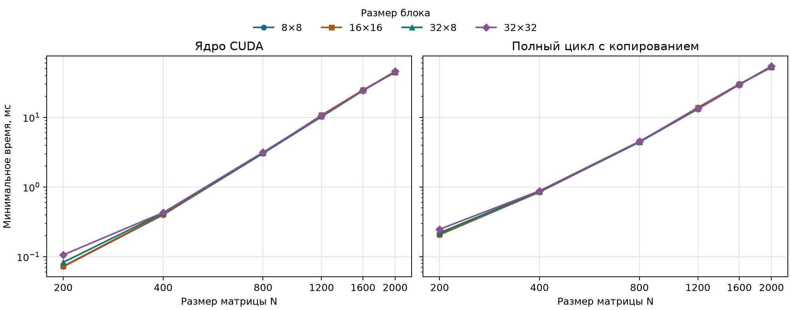
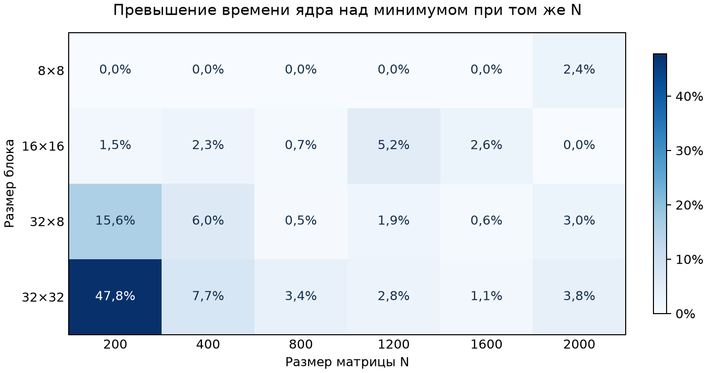

## Задание

Модифицировать программу лабораторной работы № 1 для параллельного умножения квадратных матриц по технологии CUDA. Исследовать зависимость времени выполнения от размера матриц и конфигурации сетки блоков. Проверить результаты вычислений с помощью NumPy.

Входные данные — два текстовых файла матриц. Каждый начинается со строки `rows cols`, за которой идут значения элементов. Программа сохраняет матрицу произведения в том же формате и выводит размеры матриц, параметры запуска, объём данных и время.

## Реализация

Из лабораторной работы № 1 перенесены класс `Matrix`, хранение элементов типа `double` в непрерывном массиве по строкам, формат файлов и генератор входных данных. Код запуска и вывода метрик находится в [src/main.cpp](src/main.cpp), а реализация CUDA — в [src/multiply_cuda.cu](src/multiply_cuda.cu).

Поток CUDA вычисляет один элемент результата по формуле

$$
C_{ij}=\sum_{k=0}^{N-1} A_{ik} B_{kj}.
$$

Координата по оси X определяет столбец $j$, по оси Y — строку $i$. Для блока $B_x \times B_y$ размеры сетки составляют $\lceil N/B_x\rceil$ по X и $\lceil N/B_y\rceil$ по Y. Потоки, координаты которых выходят за пределы матрицы, завершаются без обращения к её элементам. Каждый элемент результата записывает один поток.

Видеопамять для трёх матриц выделяется до прогрева. В каждом повторе программа передаёт $A$ и $B$ на GPU, запускает ядро и копирует $C$ обратно в оперативную память. Два CUDA Events ограничивают участок с ядром. Часы хоста измеряют полный цикл обмена и вычисления.

## Экспериментальный стенд

| Компонент | Конфигурация |
|---|---|
| ОС | Windows 10 |
| Процессор | Intel Core i5-12400F, 6 ядер и 12 потоков |
| Видеокарта | NVIDIA GeForce RTX 4060 Ti, 8 ГБ |
| Оперативная память | 16 ГБ DDR4-3200 |
| Среда разработки | Visual Studio 2022 Community, MSVC |
| CUDA Toolkit | 12.9, `nvcc` V12.9.86 |
| Драйвер NVIDIA | 616.56, модель драйвера WDDM |
| CMake | 4.2.3 |
| Python | 3.13.0 |

Версия Toolkit взята из вывода `nvcc --version`. В инструкции проекта задана сборка Release для `sm_89`. Точная версия MSVC в предоставленных сведениях отсутствует.

## Методика экспериментов

В основной серии использованы квадратные матрицы размером 200, 400, 800, 1200, 1600 и 2000. Для каждого размера проверены блоки 8×8, 16×16, 32×8 и 32×32, всего 24 комбинации. При фиксированном $N$ все конфигурации используют одну пару входных матриц. Для каждой комбинации выполнялись один прогрев и пять измеряемых повторов.

Для времени ядра и полного цикла сохраняются минимум и среднее. Время ядра измерялось с помощью CUDA Events, а время полного цикла — с момента передачи входных матриц до завершения возврата результата. Чтение и запись файлов, выделение памяти и верификация выполнялись вне замеров. Производительность ядра вычислялась по формуле $2N^3/(10^9 t_{\min})$, где $t_{\min}$ — минимальное время ядра в секундах.

Для каждой комбинации конфигурации и размера матрица результата сравнивалась с произведением $C_{ref}$, вычисленным через `A @ B` в NumPy. Использовался критерий из лабораторной работы № 1.

$$
\frac{\max_{i,j}|C_{ij}-C_{ref,ij}|}
{\max\left(1,\max_{i,j}|C_{ref,ij}|\right)} \le 10^{-7}.
$$

## Результаты

Полные замеры приведены в [results/bench.csv](results/bench.csv). [Пробная серия](results/trial/bench.csv) сохранена отдельно. В таблице для каждого $N$ показана конфигурация с наименьшим временем ядра в основной серии.

| N | Блок | Сетка | Ядро min, мс | Ядро mean, мс | Полный цикл min, мс | Полный цикл mean, мс | GFLOPS ядра |
|---:|:---:|:---:|---:|---:|---:|---:|---:|
| 200 | 8×8 | 25×25 | 0,071840 | 0,073632 | 0,2062 | 0,21158 | 222,72 |
| 400 | 8×8 | 50×50 | 0,398880 | 0,404154 | 0,8471 | 0,86510 | 320,90 |
| 800 | 8×8 | 100×100 | 3,045568 | 3,049562 | 4,4197 | 4,45180 | 336,23 |
| 1200 | 8×8 | 150×150 | 10,196192 | 10,200685 | 13,1595 | 13,30044 | 338,95 |
| 1600 | 8×8 | 200×200 | 24,117439 | 24,172595 | 29,4215 | 29,57942 | 339,67 |
| 2000 | 16×16 | 125×125 | 44,128448 | 46,332608 | 52,1573 | 54,45728 | 362,58 |

Все 24 результата прошли проверку NumPy. Наибольшее значение нормированной ошибки составило $4{,}36\times10^{-15}$ при $N=1600$. Допуск составлял $10^{-7}$.

*Рисунок 1. Минимальное время по размеру матрицы. На каждом графике по одной кривой для каждой конфигурации блока. Обе оси логарифмические.*

*Рисунок 2. Превышение минимального времени ядра над лучшим временем при фиксированном $N$. Ноль соответствует лучшему результату для этого размера.*

Оба рисунка построены скриптом [scripts/plot.py](scripts/plot.py) по основной серии.

## Анализ результатов

При блоке 8×8 удвоение $N$ с 400 до 800 увеличило минимальное время ядра в 7,64 раза, а с 800 до 1600 — в 7,92 раза. Эти значения близки к восьмикратному росту числа операций при удвоении размера матрицы.

Блок 8×8 дал наименьшее время ядра для пяти размеров от 200 до 1600, а при $N=2000$ лидировал блок 16×16. Для $N=200$ время ядра с блоком 32×32 оказалось на 47,8% выше лучшего. При $N\ge400$ разница между лучшим и худшим результатом составила от 2,6% до 7,7%.

У блоков 16×16 и 32×8 по 256 потоков. При $N=200$, 400 и 2000 меньший минимум показал 16×16, а при 800, 1200 и 1600 — 32×8. Если сравнить среднее время ядра, при $N=200$ лидирует 16×16, а при $N=2000$ — 32×8. Выбор лучшего блока в этих случаях зависит от метрики.

Для конфигураций с наименьшим временем ядра отношение минимального времени полного цикла к минимальному времени ядра снизилось с 2,87 при $N=200$ до 1,18 при $N=2000$. Передача данных, запуск и синхронизация сильнее влияют на полное время при малых матрицах. Минимумы двух метрик могут приходиться на разные повторы, поэтому их разность даёт ориентир, а время копирования отдельно не измерялось.

Для справки, архивная последовательная серия лабораторной № 1 при $N=2000$ даёт минимум 3998,71 мс. Отношение этого времени к минимуму CUDA составляет 90,6 для ядра и 76,7 для полного цикла. Это сравнение двух серий с разными границами замера. В последовательной программе измеряемый вызов создаёт матрицу результата, а CUDA выделяет память до начала замера. [Замеры последовательной версии](results/lab01_cpu.csv)

## Выводы

Реализовано параллельное умножение матриц на CUDA. Результаты всех 24 конфигураций совпали с эталоном NumPy в пределах заданного допуска. При $N=2000$ и блоке 16×16 минимальное время ядра составило 44,13 мс, а минимальное время полного цикла — 52,16 мс. Производительность ядра по минимальному времени достигла 362,58 GFLOPS. Наименьшее время ядра для большинства размеров показал блок 8×8, а влияние формы блока и обмена с GPU оказалось наиболее заметным при $N=200$.
